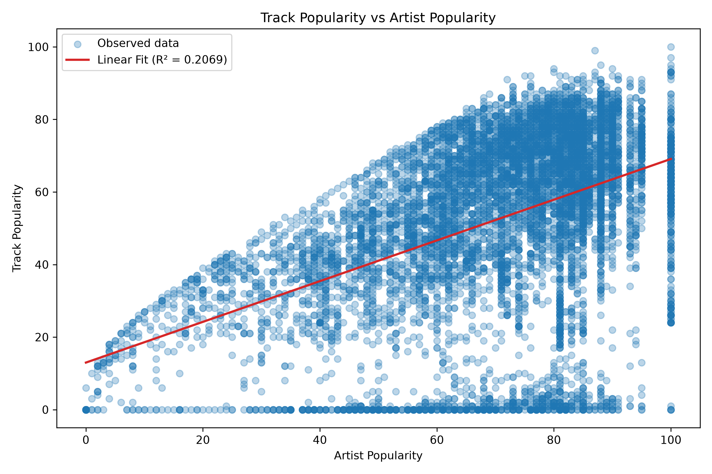
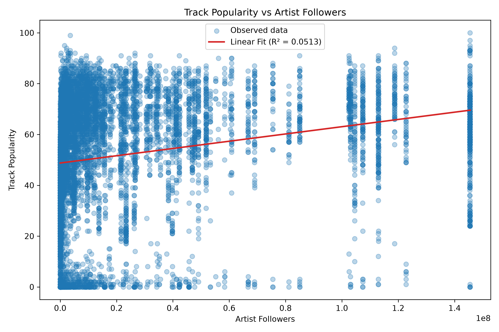
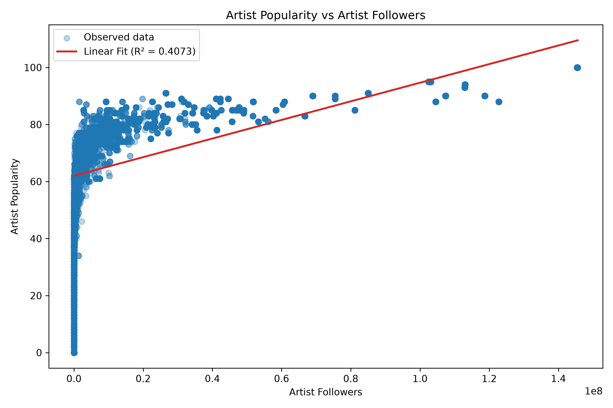

# Practica 5 - Modelos Lineales y Correlacion
## Mineria de Datos | Dataset: Spotify Track Data 

## 1. Objetivo

Generar un modelo lineal para al menos una relacion entre variables del dataset, con su grafica correspondiente y la metrica de R2. Siguiendo la misma idea del archivo de referencia, en lugar de ajustar un unico modelo aislado, se evaluaron tres relaciones distintas para comparar que tan bien o mal se ajusta una recta en cada caso.

## 2. Comparaciones

| Modelo | Variable X | Variable Y | Hipotesis |
|---|---|---|---|
| 1 | artist_popularity | track_popularity | Comprobar si la popularidad general de un artista se transfiere de forma directa a la popularidad individual de cada una de sus canciones |
| 2 | artist_followers | track_popularity | Evaluar si tener una base masiva de seguidores garantiza que cualquier cancion lanzada por el artista alcance alto impacto y reproducciones |
| 3 | artist_followers | artist_popularity | Verificar que tan bien explica el volumen acumulado de seguidores la metrica global de popularidad del artista en la plataforma |

## 3. Metodologia

Los tres modelos se ajustaron por Minimos Cuadrados Ordinarios (OLS) mediante la libreria statsmodels.api, agregando el intercepto mediante sm.add_constant() para que la recta calcule tanto la pendiente como el punto de corte con el eje Y.

## 4. Modelo 1 - Popularidad del artista vs. popularidad de la pista

| Metrica | Valor |
|---|---|
| Observaciones | 8,772 |
| R2 | 0.2069 |
| Coeficiente (artist_popularity) | 0.5613 |
| Intercepto | 12.9716 |
| P > &#124;t&#124; | 0.000 |

El coeficiente indica que, en promedio, por cada punto adicional en la popularidad del artista, la popularidad de la pista aumenta en 0.56 puntos. El p-value de 0.000 confirma que esta relacion no es producto del azar. 

El valor de R2 es de 0.2069, lo que significa que la popularidad del artista explica apenas el 20.7% de la variacion en la popularidad de una cancion. El 79.3% restante depende de otros factores no capturados por esta variable.

## 5. Modelo 2 - Seguidores del artista vs. popularidad de la pista

| Metrica | Valor |
|---|---|
| Observaciones | 8,772 |
| R2 | 0.0513 |
| Coeficiente (artist_followers) | 1.4288e-07 |
| Intercepto | 48.7628 |
| P > &#124;t&#124; | 0.000 |

Este modelo no predice realmente que una gran cantidad de seguidores asegura el exito de cualquier cancion. El coeficiente es de 1.4288e-07, lo que quiere decir que se necesitan aproximadamente 7 millones de seguidores adicionales para que una cancion gane apenas 1 punto en su indice de popularidad.

El R2 de 0.0513 demuestra que el numero de seguidores explica unicamente el 5.1% de la varianza en la popularidad de la cancion. Aunque el p-value es estadisticamente significativo debido al gran volumen de datos, su capacidad predictiva es practicamente nula.

## 6. Modelo 3 - Seguidores del artista vs. popularidad del artista

| Metrica | Valor |
|---|---|
| Observaciones | 8,772 |
| R2 | 0.4073 |
| Coeficiente (artist_followers) | 3.2638e-07 |
| Intercepto | 62.0204 |
| P > &#124;t&#124; | 0.000 |

Este es el modelo con mayor poder explicativo entre los tres analizados. El R2 de 0.4073 indica que el 40.7% de la variabilidad en la popularidad del artista se explica linealmente por su cantidad de seguidores acumulados. 

A diferencia de los modelos anteriores donde se intentaba predecir una propiedad de la cancion a partir de una variable del artista, aqui ambas variables corresponden al nivel del artista, lo que genera una correlacion mucho mayor.

## 7. Resumen comparativo

| Modelo | R2 | Capacidad Predictiva |
|---|---|---|
| 1. artist_popularity a track_popularity | 0.2069 | Baja a moderada |
| 2. artist_followers a track_popularity | 0.0513 | Casi nula |
| 3. artist_followers a artist_popularity | 0.4073 | Moderada a buena |

Este resumen conecta directamente con lo observado en la Practica 4: un valor de p extremadamente bajo (p < 0.001) no equivale a un efecto predictivo fuerte

## 8. Limitaciones

Los modelos evaluados son regresiones lineales simples con una sola variable independiente. No controlan por efectos simultaneos como el genero musical, la fecha de lanzamiento de la pista o la duracion de la misma.

La relacion entre seguidores y popularidad presenta rendimientos decrecientes evidentes en valores altos de seguidores, lo cual un modelo lineal simple no captura de forma completa al forzar una pendiente constante.

Ninguno de estos modelos establece causalidad: que un artista con mas seguidores tenga mayor popularidad no determina si los seguidores causaron la popularidad o si la popularidad previa atrajo a los seguidores.

