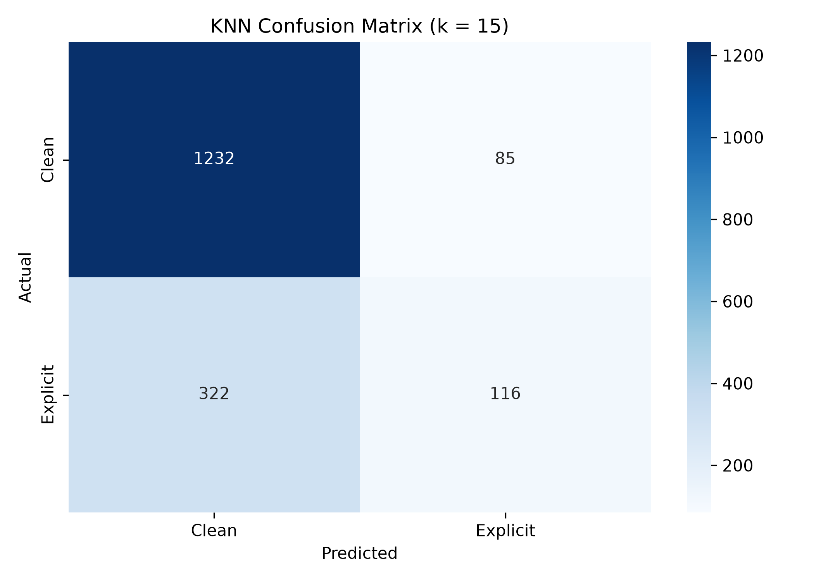

# Practica 6 - Clasificacion de Datos (KNN)
## Mineria de Datos | Dataset: Spotify Track Data

## 1. Objetivo

Crear y evaluar un modelo de clasificacion supervisada utilizando el algoritmo de K Vecinos Mas Cercanos (KNN) para predecir si una cancion es explicita (explicit: True o False) a partir de sus caracteristicas cuantitativas y de lanzamiento. 

Siguiendo con el analisis de las practicas anteriores, en la que se obtuvo una diferencia en reproducciones entre canciones con y sin contenido explicito, este modelo permite determinar si las variables duracion, popularidad y difusion del artista ofrecen suficiente separabilidad para discriminar la naturaleza explicita de una pista sin requerir analisis directo de su letra.

## 2. Seleccion de variables y preparacion de datos

Se seleccionaron como variables predictoras (features):
- track_popularity: Indice de popularidad de la pista (0 a 100).
- track_duration_ms: Duracion de la pista en milisegundos.
- artist_popularity: Indice de popularidad general del artista (0 a 100).
- artist_followers: Cantidad de seguidores del artista en la plataforma.
- album_total_tracks: Total de canciones contenidas en el album o sencillo.
- track_number: Numero de posicion que ocupa la cancion dentro del lanzamiento.
- album_type: Categoria de publicacion (album, single o compilation).

Preparacion realizada:
- El dataset cuenta con 8,772 registros completos sin presencia de valores nulos.
- La variable objetivo explicit se codifico en formato binario numerico (0 = Clean / No explicita, 1 = Explicit / Explicita).
- La variable categorica album_type se transformo mediante codificacion One-Hot Encoding (pd.get_dummies con drop_first=True) para evitar problemas de colinealidad.

Distribucion de la variable objetivo:
- Clean (0): 6,582 registros (75.03%)
- Explicit (1): 2,190 registros (24.97%)

## 3. Entrenamiento del modelo baseline

El proceso de modelado se realizo bajo los siguientes criterios metodologicos:

- Estandarizacion con StandardScaler: Variables con escalas elevadas como artist_followers (que alcanza decenas de millones) o track_duration_ms dominarian por completo el calculo de distancias frente a variables como track_popularity (0 a 100) si no se normalizan a media cero y varianza unitaria.
- Se utilizo train_test_split con un 80% para entrenamiento (7,017 observaciones) y un 20% para evaluacion (1,755 observaciones), utilizando una semilla fija (random_state=42) y estratificacion (stratify=y) para preservar la proporcion exacta de clases en ambos subconjuntos.

| Valor de K | Exactitud (Accuracy) | Macro F1 | Precision (Explicit) | Recall (Explicit) | F1-Score (Explicit) |
|---|---|---|---|---|---|
| k = 3 | 0.7476 (74.76%) | 0.6312 | 0.4924 (49.24%) | 0.3721 (37.21%) | 0.4239 |
| k = 5 | 0.7630 (76.30%) | 0.6366 | 0.5390 (53.90%) | 0.3470 (34.70%) | 0.4222 |
| k = 15 (Elegido) | 0.7681 (76.81%) | 0.6107 | 0.5771 (57.71%) | 0.2648 (26.48%) | 0.3631 |
| k = 31 | 0.7744 (77.44%) | 0.5910 | 0.6479 (64.79%) | 0.2100 (21.00%) | 0.3172 |

Analisis de las variaciones probadas:
- Con K muy pequeno (k = 3 o k = 5): El modelo es muy sensible al ruido local y a canciones con caracteristicas atipicas. Aunque detecta un poco mas de canciones explicitas, comete demasiados errores, ya que la precision en explicit cae por debajo del 50% en k=3 y la exactitud general baja a 74.76%.
- Con K muy grande (k = 31): Como el dataset esta desbalanceado (75% canciones limpias y 25% explicitas), una vecindad grande hace que las canciones limpias acaparen casi todas las votaciones por pura mayoria numerica. Esto provoca que el modelo casi no detecte pistas explicitas: el recall baja a 21.00% y el Macro F1 cae a 0.5910.
- Por que se eligio k = 15: Representa el mejor balance entre los ejemmplos anteriores. La exactitud global se consolida en 76.81%, la precision para canciones explicitas sube a casi el 58%.

## 4. Resultados del modelo baseline

A continuacion se presenta la matriz de confusion generada sobre el conjunto de prueba:

Metricas globales y por clase obtenidas sobre el conjunto de prueba (1,755 observaciones):

| Metrica | Clean (0) | Explicit (1) | Macro Promedio | Ponderado Promedio |
|---|---|---|---|---|
| Precision | 0.7928 | 0.5771 | 0.6850 | 0.7390 |
| Recall (Sensibilidad) | 0.9355 | 0.2648 | 0.6001 | 0.7681 |
| F1-Score | 0.8582 | 0.3631 | 0.6107 | 0.7347 |
| Exactitud (Accuracy) | - | - | - | 0.7681 |

## 5. Analisis de la matriz de confusion y errores

El desglose de clasificaciones reales contra predichas se resume en la siguiente tabla:

| Real \ Predicho | Clean (Prediccion) | Explicit (Prediccion) | Total Real |
|---|---|---|---|
| Clean (Real) | 1,232 (93.55%) | 85 (6.45%) | 1,317 |
| Explicit (Real) | 322 (73.52%) | 116 (26.48%) | 438 |

Patrones identificados:

1. El modelo identifica con exito el 93.55% de las pistas limpias (1,232 de 1,317 canciones), incurriendo en una tasa reducida de falsos positivos (85 canciones).
2. De las 438 pistas explicitas en prueba, el clasificador solo captura 116 (recall de 26.48%). Las 322 restantes (73.52%) son clasificadas incorrectamente como contenido apto para todo publico.
3. Al estar el conjunto desbalanceado (tres pistas limpias por cada pista explicita), las canciones explicitas comparten valores muy similares de duracion, popularidad y seguidores con canciones convencionales, provocando que en la vecindad de 15 vecinos predominen votos de la clase mayoritaria.

