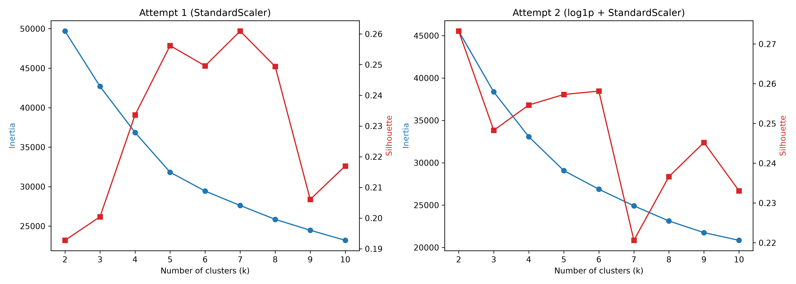
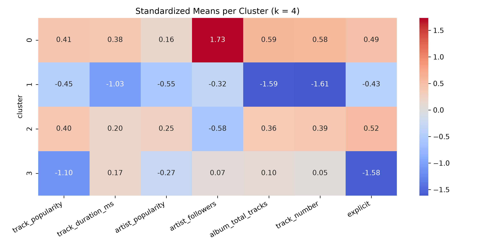
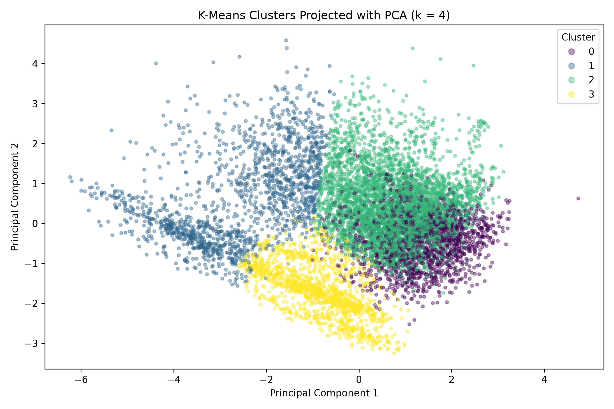

# Practica 7 - Agrupamiento de Datos (K-Means)
## Mineria de Datos | Dataset: Spotify Track Data

## 1. Objetivo

Crear y evaluar un modelo de agrupamiento utilizando el algoritmo K-Means para descubrir perfiles naturales de canciones a partir de sus caracteristicas cuantitativas y de lanzamiento.

## 2. Seleccion de variables y preparacion de datos

Se seleccionaron las siguientes variables:
- track_popularity: Indice de popularidad de la pista (0 a 100).
- track_duration_ms: Duracion de la pista en milisegundos.
- artist_popularity: Indice de popularidad general del artista (0 a 100).
- artist_followers: Cantidad de seguidores del artista en la plataforma.
- album_total_tracks: Total de canciones contenidas en el album o sencillo.
- track_number: Numero de posicion que ocupa la cancion dentro del lanzamiento.
- explicit: Contenido explicito, codificado en binario (0 = Clean, 1 = Explicit).

Preparacion realizada:
- No se incluyeron variables de texto o identificadores (track_id, track_name, artist_name, album_id, album_name, artist_genres) porque K-Means trabaja con distancias numericas y estas columnas no tienen un orden ni una magnitud que comparar.
- No se incluyo album_type porque su informacion ya esta reflejada en album_total_tracks (un single tiene 1 o pocas canciones), y agregar columnas One-Hot duplicaria ese efecto en la distancia.

## 3. Escalado y transformaciones

Se aplico StandardScaler a todas las variables porque K-Means agrupa por distancia, y sin escalar una variable como artist_followers (hasta 145 millones) dominaria por completo el calculo frente a variables como track_popularity (0 a 100) o explicit (0 o 1).

Se probaron dos versiones de preparacion para comparar cual produce mejores grupos:
- Intento 1: solo StandardScaler sobre los valores originales.
- Intento 2: aplicar log1p a artist_followers, album_total_tracks y track_number antes de escalar ya que Estas tres variables estan muy sesgadas (mediana de 6 millones de seguidores contra un maximo de 145 millones, albumes de hasta 181 canciones y posiciones de hasta 102).

## 4. Eleccion de k - Metodo del codo y silhouette

Se corrio K-Means con k de 2 a 10 en ambos intentos, usando random_state=42 y n_init=10 para que el resultado sea reproducible y no dependa de una sola inicializacion de centroides. Para cada k se calculo la inercia (que tan compactos son los grupos) y el coeficiente silhouette (que tan separados estan los grupos entre si, de -1 a 1).

| k | Inercia Intento 1 | Silhouette Intento 1 | Inercia Intento 2 | Silhouette Intento 2 |
|---|---|---|---|---|
| 2 | 49,693 | 0.1927 | 45,535 | 0.2732 |
| 3 | 42,691 | 0.2004 | 38,360 | 0.2483 |
| 4 | 36,858 | 0.2336 | 33,072 | 0.2547 |
| 5 | 31,822 | 0.2562 | 29,071 | 0.2573 |
| 6 | 29,440 | 0.2496 | 26,875 | 0.2581 |
| 7 | 27,610 | 0.2609 | 24,914 | 0.2206 |
| 8 | 25,857 | 0.2494 | 23,129 | 0.2366 |
| 9 | 24,477 | 0.2061 | 21,755 | 0.2452 |
| 10 | 23,202 | 0.2170 | 20,848 | 0.2331 |

Analisis de las variaciones:
- Intento 1: El silhouette es inestable, sube y baja entre k consecutivos (0.2562 en k = 5, 0.2496 en k = 6, 0.2609 en k = 7 y cae a 0.2061 en k = 9). Su maximo en k = 7 se debe a grupos formados solo por valores extremos, como artistas con 118 millones de seguidores o albumes de 43 canciones. Ademas, su inercia es mayor que la del Intento 2 para cualquier k, por lo que se descarto.
- Intento 2 con k = 2 y k = 3: k = 2 tiene el silhouette mas alto (0.2732), pero en la grafica del codo la inercia cae despues de ese punto (7,175 de k = 2 a k = 3 y 5,288 de k = 3 a k = 4), lo que indica que todavia quedan grupos sin separar. En la practica solo divide artistas conocidos contra artistas pequenos. k = 3 tiene el silhouette mas bajo del rango 2 a 6 (0.2483).
- Intento 2 con k = 5 y k = 6: El silhouette queda casi plano (0.2547, 0.2573 y 0.2581 para k = 4, 5 y 6), asi que agregar clusters no mejora la separacion.
- Por que se eligio el Intento 2 con k = 4: Es el punto donde termina la caida fuerte de la inercia y comienza la zona plana del silhouette. Se eligio el k mas pequeno de esa zona porque da la misma calidad de separacion con menos grupos y mas faciles de interpretar.

## 5. Resultados del modelo final

Modelo final: Intento 2, k = 4, inercia = 33,072, silhouette = 0.2547.

Perfil de cada cluster (valores originales):

| Cluster | Canciones | Popularidad pista | Duracion (min) | Explicit | Popularidad artista | Seguidores | Canciones del album | Posicion |
|---|---|---|---|---|---|---|---|---|
| 0 | 1,615 | 61.5 | 3.67 | 1.00 | 81.5 | 38.3 M | 16.4 | 7.2 |
| 1 | 1,616 | 27.4 | 2.92 | 0.11 | 38.8 | 0.13 M | 11.1 | 3.8 |
| 2 | 4,128 | 56.9 | 3.77 | 0.00 | 76.9 | 31.3 M | 18.0 | 7.6 |
| 3 | 1,415 | 56.3 | 3.21 | 0.28 | 72.0 | 15.7 M | 1.6 | 1.1 |

Interpretacion de cada cluster:
- Cluster 0, canciones explicitas de artistas grandes: todas sus canciones son explicitas, provienen de albumes completos y tienen la popularidad de artista y de pista mas alta del dataset.
- Cluster 1, artistas pequenos o emergentes: popularidad de pista (27.4) y de artista (38.8) muy por debajo del resto y apenas 130 mil seguidores promedio. Tambien tienen las canciones mas cortas.
- Cluster 2, canciones limpias de albumes de artistas grandes: es el grupo mas numeroso (47% del dataset), sin contenido explicito, con las canciones mas largas y los albumes mas extensos.
- Cluster 3, singles: albumes de 1.6 canciones en promedio y casi siempre en la posicion 1. Mantienen una popularidad alta aunque sus artistas tienen menos seguidores que los de los clusters 0 y 2.

En la proyeccion con PCA a dos dimensiones los clusters 1 (artistas pequenos) y 3 (singles) ocupan zonas propias y bien definidas. En cambio, los clusters 0 y 2 aparecen encimados en la misma zona, porque se parecen en casi todas las variables y lo que los separa es explicit, que no queda bien representada en estos dos componentes. Esto coincide con el silhouette de 0.25: hay estructura en los datos, pero los grupos no estan completamente separados.

## 6. Analisis y limitaciones

- La variable explicit tiene un peso muy fuerte en el agrupamiento. Esto muestra por que los clusters 0 y 2 son casi identicos en todo excepto en explicit. Las canciones explicitas y limpias de artistas grandes tienen caracteristicas muy parecidas, por eso KNN no puede separarlas.
- Un silhouette alrededor de 0.25 indica grupos debiles. Las canciones no forman grupos totalmente separados sino que existe una transicion continua entre ellas.