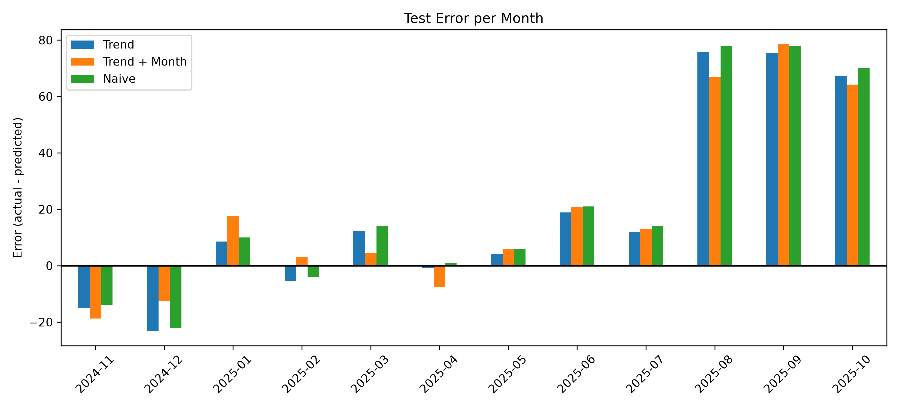
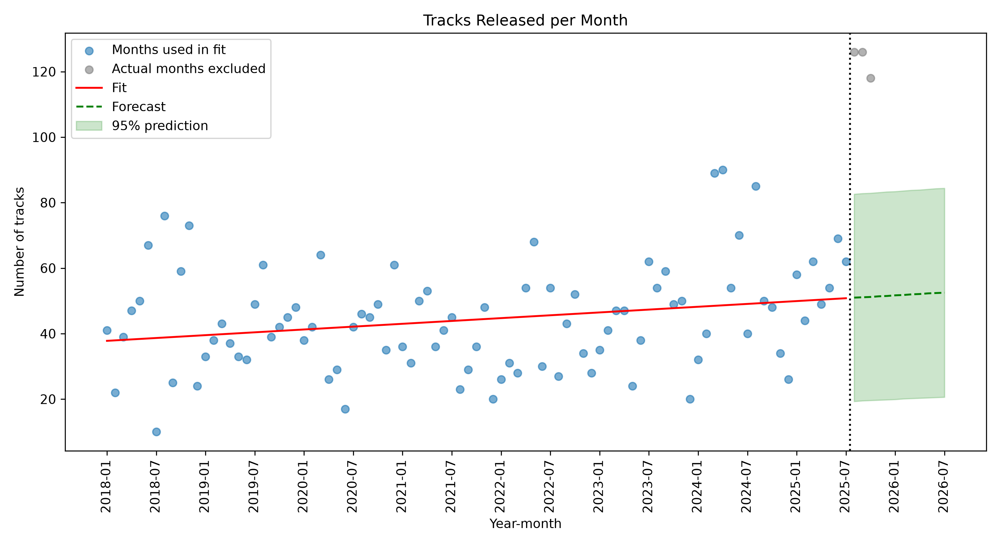

# Practica 8 - Pronostico (Forecasting)
## Mineria de Datos | Dataset: Spotify Track Data

## 1. Objetivo

Crear un modelo de regresion sobre una serie de tiempo para predecir datos futuros. La serie es el numero de canciones lanzadas por mes segun la fecha de lanzamiento del album, y el pronostico cubre los 12 meses siguientes al ultimo mes usado en el ajuste (agosto de 2025 a julio de 2026).

## 2. Serie y variables

La unica columna de fecha del dataset es album_release_date, por lo que se contaron las canciones por mes de lanzamiento. Se uso el mes como unidad porque por dia habria muchos dias en cero y por año  solo quedarian unos pocos puntos.

Preparacion realizada:
- Se descartaron las 201 filas cuya fecha solo tiene año  (por ejemplo 2009) o año  y mes. Al convertirlas a fecha, pandas las manda al primer dia de enero y eso inflaria artificialmente ese mes.
- Se tomo el periodo de enero de 2018 a octubre de 2025, lo que da 94 meses. Antes de 2018 hay muy pocos lanzamientos por mes y la serie seria mas ruido que tendencia. A partir de 2018 el volumen es mas estable, entre 20 y 90 canciones por mes en casi todos los meses.

## 3. Validacion

| Conjunto | Meses | Periodo |
|---|---|---|
| Ajuste | 82 | enero de 2018 a octubre de 2024 |
| Prueba | 12 | noviembre de 2024 a octubre de 2025 |

Se usaron 12 meses de prueba para que la prueba cubra un ciclo completo del año.

Se probaron tres modelos:
- Intento 1, recta: y = b0 + b1x. Supone que el numero de lanzamientos crece o baja de forma constante.
- Intento 2, recta mas mes: la misma recta mas 11 variables dummy del mes (enero queda como referencia). Se probo porque en la serie se ven meses que se repiten altos o bajos, como diciembre que casi siempre es bajo.
- Modelo ingenuo: repite en los 12 meses de prueba el ultimo valor del ajuste (octubre de 2024, 48 canciones). Sirve como linea base, si un modelo no le gana no aporta nada.

Recta ajustada con los 82 meses: y = 38.17 + 0.1337x (p-value de la pendiente = 0.074). El R2 en el ajuste fue de 0.039 para la recta y de 0.197 para la recta mas mes.

Como metrica se uso el MAE (error absoluto medio), que se expresa en canciones por mes.

| Mes | Real | Recta | Recta mas mes | Ingenuo |
|---|---|---|---|---|
| 2024-11 | 34 | 49.1 | 52.7 | 48 |
| 2024-12 | 26 | 49.3 | 38.7 | 48 |
| 2025-01 | 58 | 49.4 | 40.4 | 48 |
| 2025-02 | 44 | 49.5 | 41.0 | 48 |
| 2025-03 | 62 | 49.7 | 57.4 | 48 |
| 2025-04 | 49 | 49.8 | 56.6 | 48 |
| 2025-05 | 54 | 49.9 | 48.0 | 48 |
| 2025-06 | 69 | 50.1 | 48.1 | 48 |
| 2025-07 | 62 | 50.2 | 49.1 | 48 |
| 2025-08 | 126 | 50.3 | 59.1 | 48 |
| 2025-09 | 126 | 50.5 | 47.4 | 48 |
| 2025-10 | 118 | 50.6 | 53.8 | 48 |

## 4. Salto de agosto a octubre de 2025

Agosto, septiembre y octubre de 2025 tienen 126, 126 y 118 canciones, casi el triple del promedio del resto de la serie (alrededor de 45). Ningun modelo se acerca a esos valores y la mayor parte del MAE de los tres viene de esos tres meses.

En ningun año  anterior se ve un salto parecido en esos meses, por lo que no se puede explicar por la epoca del año . Como hipotesis, el dataset se armo a finales de 2025 y sobrerrepresenta los lanzamientos mas recientes (por ejemplo, si las canciones se tomaron de listas o busquedas que favorecen lo nuevo). 

Por eso el MAE se calculo de dos formas: con los 12 meses de prueba y con los primeros 9 (sin agosto a octubre de 2025).

| Modelo | MAE 12 meses | MAE 9 meses |
|---|---|---|
| Recta | 26.58 | 11.16 |
| Recta mas mes | 26.14 | 11.56 |
| Ingenuo | 27.67 | 11.78 |

Analisis de las variaciones:
- Con los 12 meses gana la recta mas mes, pero solo por agosto, donde ambos modelos fallaron por mucho. Esa ventaja no es real.
- Con los 9 meses normales la recta tiene el menor error (11.16).
- La recta mas mes se ajusta mejor a los datos de entrenamiento (R2 de 0.197 contra 0.039), pero predice peor. Cada mes solo tiene unos 7 valores, asi que el modelo aprende ruido y no un patron real.
- Los tres modelos tienen errores muy parecidos, lo que indica que la serie cambia mucho de un mes a otro sin un patron claro.

Por que se eligio la recta: tiene el menor error en los meses normales, le gana al modelo ingenuo y es el modelo mas simple. Agregar los meses hace el modelo mas complejo sin mejorar el pronostico.

## 5. Modelo final y pronostico

Para el pronostico se reajusto la recta con 91 meses (enero de 2018 a julio de 2025), dejando fuera agosto a octubre de 2025 por la hipotesis anterior. Este corte se decidio despues de ver el comportamiento de esos meses en la validacion, y asi se deja asentado.

| Parametro | Modelo de 82 meses | Modelo de 91 meses |
|---|---|---|
| Intercepto | 38.17 | 37.80 |
| Pendiente | 0.1337 | 0.1445 |
| p-value de la pendiente | 0.074 | 0.022 |

Los parametros cambian poco entre los dos modelos, por lo que el MAE de la validacion se reporta como referencia del modelo final, teniendo presente que se calculo con el de 82 meses. Con los 91 meses la pendiente ya es significativa al 5%.

En la grafica, los puntos azules son los meses usados en el ajuste, los grises son los tres meses reales que quedaron fuera, la linea roja es la recta ajustada y la linea verde punteada es el pronostico con la banda de prediccion al 95%.

| Mes | Pronostico | Limite inferior | Limite superior |
|---|---|---|---|
| 2025-08 | 51.0 | 19.3 | 82.6 |
| 2025-09 | 51.1 | 19.5 | 82.8 |
| 2025-10 | 51.2 | 19.6 | 82.9 |
| 2025-11 | 51.4 | 19.7 | 83.1 |
| 2025-12 | 51.5 | 19.8 | 83.3 |
| 2026-01 | 51.7 | 19.9 | 83.4 |
| 2026-02 | 51.8 | 20.1 | 83.6 |
| 2026-03 | 52.0 | 20.2 | 83.8 |
| 2026-04 | 52.1 | 20.3 | 83.9 |
| 2026-05 | 52.3 | 20.4 | 84.1 |
| 2026-06 | 52.4 | 20.5 | 84.3 |
| 2026-07 | 52.5 | 20.6 | 84.4 |

 Sumando los valores centrales, el pronostico para los 12 meses es de aproximadamente 621 canciones.

## 6. Conclusiones

La recta estima un crecimiento muy lento, de unas 0.14 canciones mas por cada mes que pasa, es decir, alrededor de 1.7 canciones mas por año . El pronostico va de 51 canciones en agosto de 2025 a 52.5 en julio de 2026, con una banda de unas 32 canciones por encima y por debajo del valor central.

En la validacion la recta fue el mejor modelo en los meses normales, pero solo le gano al modelo ingenuo por 0.6 canciones de MAE. Esto quiere decur que el numero de lanzamientos por mes es casi constante con mucho ruido, y que la tendencia aporta poco.

El pronostico depende de la decision de excluir agosto a octubre de 2025. Si ese salto fuera real y no un sesgo de recoleccion, la recta estaria subestimando los proximos meses.

## 7. Limitaciones

- La serie no mide cuantas canciones se lanzan en el mundo, sino cuantas canciones de cada mes quedaron en este dataset, por lo que depende de como se armo.
- El R2 de la recta es muy bajo (0.039), el tiempo explica muy poco de la variacion entre meses.
- El corte de 91 meses se eligio despues de observar los resultados de la validacion, y el MAE reportado corresponde al modelo de 82 meses.
- El pronostico no se puede validar porque el archivo no contiene meses posteriores a octubre de 2025.

