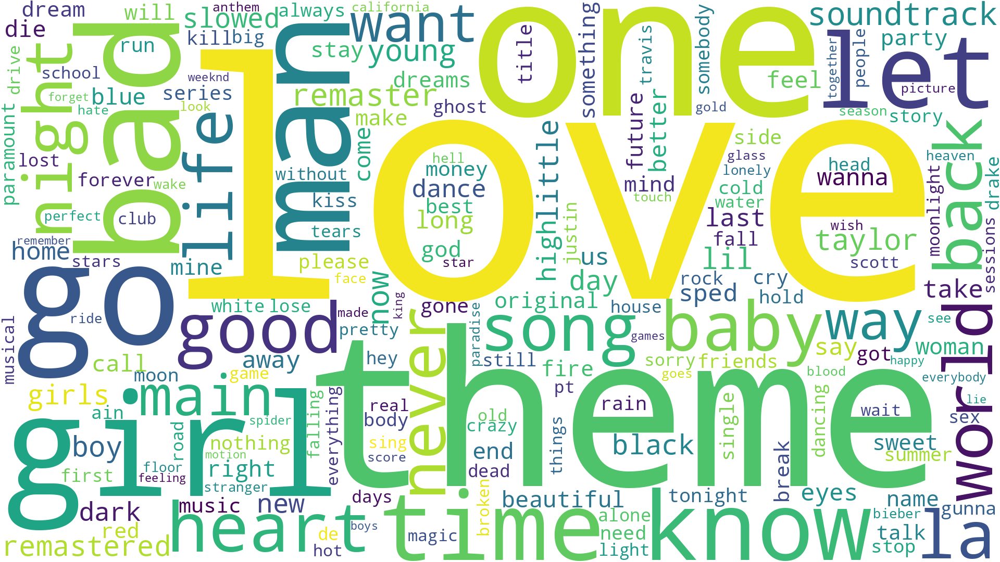
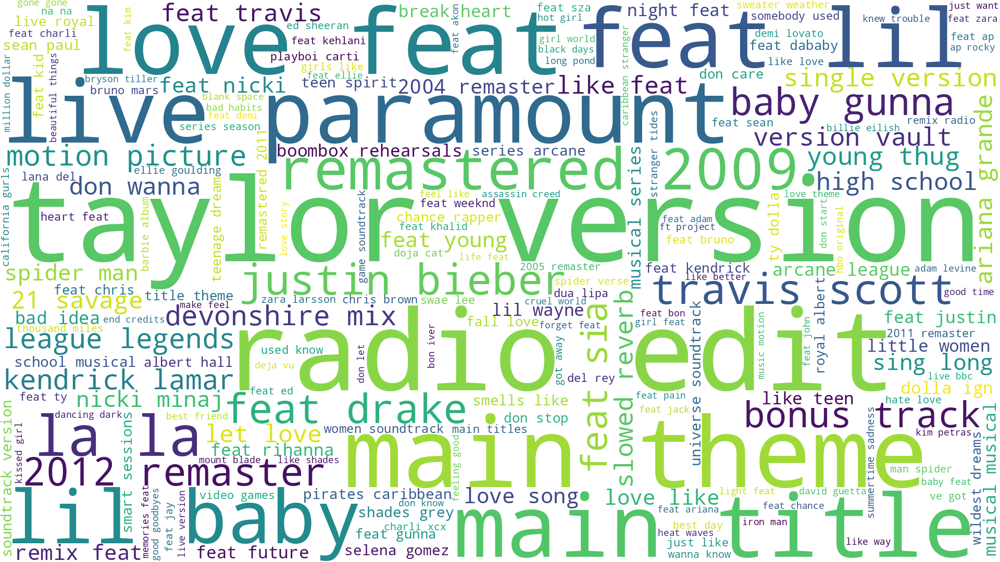
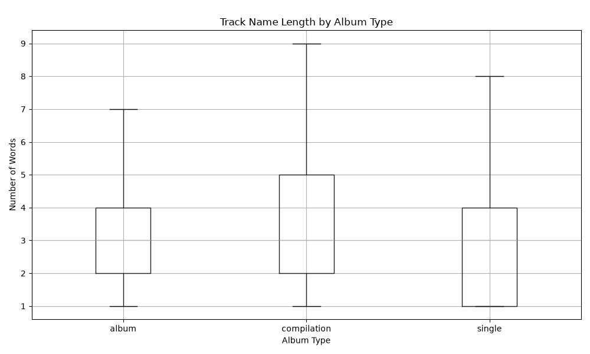

# Practica 9 - Analisis de Texto
## Mineria de Datos | Dataset: Spotify Track Data

## 1. Objetivo

Generar nubes de palabras y realizar un analisis exploratorio sobre los datos textuales del dataset de canciones de Spotify. Se analiza la columna de titulos de canciones (track_name), evaluando la composicion de su vocabulario, n-gramas frecuentes y la distribucion de su longitud segun el formato de publicacion (album_type).

## 2. Variables y preparacion de datos

Se seleccionaron dos columnas del archivo track_data_final.csv:
- track_name: Texto con el titulo de cada cancion.
- album_type: Categoria de lanzamiento a la que pertenece la pista (album, single, compilation).

## 3. Metodologia

El procesamiento se realizo en tres etapas:

1. Nube de palabras (unigramas): Se convirtieron los titulos a minusculas y se extrajeron las secuencias alfabeticas mediante la expresion regular [a-z]+. Se contaron las frecuencias absolutas con la clase Counter.
2. Nube de bigramas: Se utilizo CountVectorizer de scikit-learn con ngram_range=(2, 2), max_features=5000 y stop_words='english' para capturar pares de palabras consecutivas.
3. Longitud de titulos: Se calculo el numero de palabras por titulo dividiendo el texto por espacios, comparando la distribucion entre los tres tipos de album mediante estadisticos descriptivos y un diagrama de caja (boxplot).

## 4. Iteraciones y justificacion de decisiones

Para obtener una representacion representativa del vocabulario tematico de las canciones, se contrastaron dos intentos en el filtrado de palabras:

- Intento 1 (Linea base con stopwords estandar): Se filtraron unicamente las palabras de paro generales del idioma ingles provistas por wordcloud (STOPWORDS).
- Intento 2 (limpieza): Al listado base se anadieron etiquetas tecnicas y metadatos de produccion musical (feat, version, remix, edit, ft, live, radio, mix, deluxe), remanentes de contracciones en ingles (s, t, m, don, ve, re, ll, d) y se descartaron terminos de un solo caracter.

| Posicion | Intento 1 (Stopwords estandar) | Frecuencia | Intento 2 (Stopwords de dominio) | Frecuencia |
|---|---|---|---|---|
| 1 | feat | 653 | love | 326 |
| 2 | love | 326 | theme | 100 |
| 3 | s | 289 | one | 86 |
| 4 | t | 239 | girl | 78 |
| 5 | version | 125 | go | 78 |
| 6 | don | 117 | bad | 75 |
| 7 | remix | 113 | man | 71 |
| 8 | m | 109 | let | 69 |
| 9 | theme | 100 | know | 68 |
| 10 | one | 86 | time | 67 |
| 11 | girl | 78 | good | 66 |
| 12 | go | 78 | baby | 63 |
| 13 | bad | 75 | heart | 63 |
| 14 | man | 71 | night | 61 |
| 15 | let | 69 | world | 61 |

Analisis de las variaciones:
- En el Intento 1, el termino mas frecuente con gran diferencia fue feat (653 apariciones), seguido de letras sueltas procedentes de apostrofes en contracciones (s con 289 y t con 239), y descriptores de formato (version con 125 y remix con 113). Estos terminos no describen el contenido semantico o tematico de la pista, sino convenciones de catalogacion en plataformas de streaming.
- En el Intento 2, al eliminar estas etiquetas estructurales, se hacen visibles los temas centrales de los titulos musicales: sentimientos y relaciones (love, baby, heart), sujetos y roles (girl, man), nociones temporales (night, time) y expresiones conceptuales (world, good, bad).

## 5. Resultados

### 5.1 Nube de palabras refinada

La nube resultante destaca con la mayor prominencia el termino love, seguido de un conjunto balanceado de terminos universales en musica comercial.

### 5.2 Nube de bigramas

Los pares de palabras consecutivas capturan estructuras compuestas comunes en titulos de pistas:

| Posicion | Bigrama | Frecuencia | Contexto |
|---|---|---|---|
| 1 | taylor version | 41 | Regrabaciones de albumes de Taylor Swift |
| 2 | radio edit | 38 | Versiones editadas para difusion por radio |
| 3 | main theme | 28 | Bandas sonoras y temas principales |
| 4 | love feat | 24 | Canciones de amor con colaboracion |
| 5 | live paramount | 22 | Grabaciones en vivo en salas de concierto |
| 6 | main title | 22 | Pistas de apertura en bandas sonoras |
| 7 | feat lil | 19 | Colaboraciones con artistas de hip hop |
| 8 | lil baby | 19 | Nombre propio de artista invitado |
| 9 | remastered 2009 | 18 | Reediciones digitales remasterizadas |
| 10 | la la | 17 | Onomatopeyas y coros liricos |

### 5.3 Longitud de titulos por tipo de album

Se midio la cantidad de palabras por titulo en cada tipo de lanzamiento para evaluar si el formato de distribucion condiciona la extension del nombre.

| Tipo de album | Canciones | Media | Desv. Estandar | Minimo | Q1 (25%) | Mediana (50%) | Q3 (75%) | Maximo |
|---|---|---|---|---|---|---|---|---|
| album | 6022 | 3.10 | 2.13 | 1 | 2.0 | 3.0 | 4.0 | 21 |
| compilation | 508 | 3.98 | 2.89 | 1 | 2.0 | 3.0 | 5.0 | 16 |
| single | 2246 | 3.37 | 2.56 | 1 | 1.0 | 3.0 | 4.0 | 19 |

Observaciones:
- La mediana de longitud es identica en los tres tipos de lanzamiento (3 palabras), lo que confirma una convencion solida en la industria musical para la extension de titulos.
- Las recopilaciones (compilation) tienen la media mas alta (3.98 palabras) y una caja mas amplia (Q3 de 5 palabras).
- Los sencillos (single) presentan una media superior a la de los albumes completos (3.37 frente a 3.10 palabras), debido a que los lanzamientos individuales con frecuencia integran los creditos de artistas invitados directamente en el titulo.

## 6. Conclusiones

- El analisis de texto sobre titulos musicales requiere separar los metadatos de distribucion digital (creditos de colaboracion, versiones, remezclas) del vocabulario.
- La tematica amorosa y emocional (love, heart, baby) predomina ampliamente en los titulos, acompanada por terminos recurrentes como night, time y world.
- El analisis de bigramas revela que una porcion importante de la informacion contenida en los titulos corresponde a atribuciones de colaboraciones (feat lil, lil baby) y especificaciones de version o masterizacion (taylor version, radio edit, remastered).
- La longitud de las canciones mantiene una regla general de tres palabras por titulo, con variaciones leves donde las recopilaciones y sencillos son sistematicamente mas largos por la incorporacion de subtitulos descriptivos y creditos.

## 7. Limitaciones
- El analisis se centra en los titulos de las pistas (track_name) y no en la letra completa de las canciones (lyrics), las cuales no estan disponibles en el dataset.
